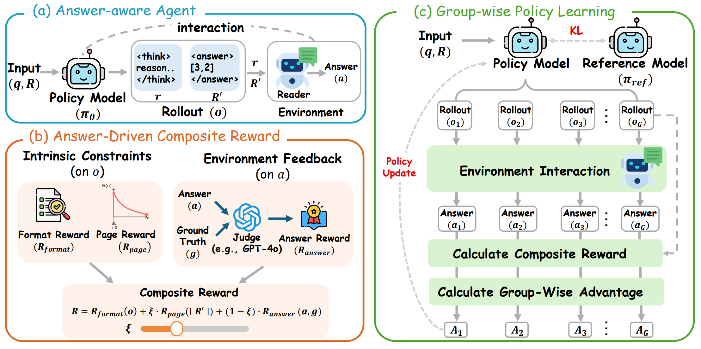
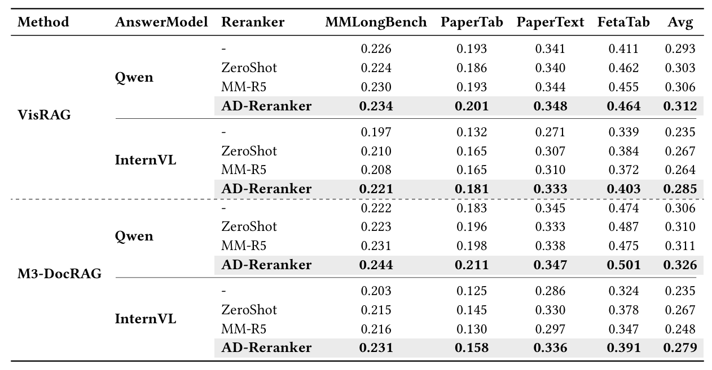

<h2 align="center"><a>Good Ranks Follow Good Answers: Unsupervised Answer-Driven Reranking for Multimodal Document QA</a></h2>
<h5 align="center">📅 Updated on <strong>2026.01.21</strong> &nbsp;&nbsp;&nbsp; ⭐ Star us on GitHub for updates!</h5>

---
## 📚 Contents


- [⚡ Highlights](#highlights)
- [🖼️ Overview](#overview)
- [📈 Performance](#performance)
- [🚀 QuickStart](#quickstart)
- [⚙️ Requirements](#requirements)
- [📁 Data Preparation](#data-preparation)
- [🧩 Data Extraction](#data-extraction)
- [🔍 Retrieval](#retrieval)
- [🎯 Training](#training)
- [🧪 Evaluation](#evaluation)
- [🧩 Post-rerank Evidence Recovery](#post-rerank-evidence-recovery)
---

## 🧩Post-rerank Evidence Recovery

This branch adds a component that runs **after** the reranker: the reranker keeps a few of the
top-10 retrieved pages and often drops pages the answer needs. For every dropped page, a
multimodal verifier (Qwen3.5-9B) answers *"does this page contain information needed to answer
the question that the selected pages lack?"*; pages with P(Yes) ≥ τ are restored (at most b),
next to their related kept page. Code in `recovery/`, stage runner `scripts/rp2.py`.

**Results on MMLongBench** (test split of 681 questions; reader Qwen2.5-VL-7B at 1,280 visual
tokens per page; local Qwen3.5-27B judge with the binary-correctness prompt of this repository):

| Reranker | Accuracy (rerank → + recovery) | Gold-page recall (rerank → + recovery) | Reader pages |
|---|---|---|---|
| Zero-shot Qwen2.5-VL-7B | 30.0 → **32.5** (p = 0.021) | 61.5 → **75.7** | 2.46 → 3.54 |
| AD-Reranker (`ckpt/`) | 30.0 → **33.6** (p = 0.006) | 52.3 → **72.0** | 1.09 → 2.32 |

Full tables (baselines, ablations, top-4 vs top-10 pool, per-type breakdowns, latency):
[docs/evidence_recovery_results.md](docs/evidence_recovery_results.md). Method and stage details:
[docs/evidence_recovery.md](docs/evidence_recovery.md).

### Run

All models are served locally with vLLM (`scripts/serve_vllm.sh`), no external API is used.

```bash
# 0) data (as in the sections below): extract pages and ColPali top-10 retrieval
python scripts/extract.py --config-name mmlb
python scripts/retrieve.py --config-name mmlb retrieval=image

# 1) model servers (set MODELS_DIR to the checkpoint folder, VLLM_BIN to the vllm binary,
#    MEDIA_ROOT to a directory that contains this repository)
export MODELS_DIR=/path/to/models VLLM_BIN=$(which vllm) MEDIA_ROOT=$PWD
LORA=adr=ckpt bash scripts/serve_vllm.sh vlm 0 0.40     # reranker + reader (+ AD-Reranker LoRA "adr")
bash scripts/serve_vllm.sh verifier_mm 1 0.30 12G        # gap-conditioned page verifier
bash scripts/serve_vllm.sh judge 1 0.50 16G              # local judge

# 2) stages (each resumes from cached outputs in results/MMLongBench/<run-name>/)
C="--config-name mmlb run-name=rp2 dataset.top_k=10 \
   models.refiner.backend=vllm models.answer.backend=vllm \
   models.refiner.model_id=/path/Qwen2.5-VL-7B-Instruct models.answer.model_id=/path/Qwen2.5-VL-7B-Instruct"
python scripts/rp2.py $C +stage=rerank                   # add models.refiner.vllm_model=adr for AD-Reranker
python scripts/rp2.py $C +stage=recover "recovery.plan=[none,ret@2,oracle@2,score20@3]"
python scripts/rp2.py $C +stage=answer models.answer.all_pixels=1003520
J="judge.prompt=adr judge.thinking=false +judge.out=judge_adr.jsonl models.answer.all_pixels=1003520"
python scripts/rp2.py $C +stage=eval $J +split=test +judge.eval_out=eval_test.json
python scripts/rp2.py $C +stage=breakdown $J +split=test
```

`recovery.plan` lists the variants as `method@budget`: `none` (reranked pages), `ret` (retrieval
backfill), `adj`, `graph`, `rel`, `ours*` (first listwise version), `scoreNN` (the method with
threshold NN/100), `scorenk`/`scorenr`/`scoreni` (ablations without the selected pages / relation
hints / page images), `oracle` (upper bound), and a `_tail` suffix for appending instead of
inserting. The end-to-end path also supports it:
`python scripts/predict.py --config-name mmlb dataset.top_k=10 recovery.enable=true`.

Changes to the existing pipeline on this branch: the refiner selection no longer overwrites its
output with `[1, 2, 3, 4]` and accepts positions 1..k; the refiner prompt uses the candidate count;
the refiner pads on the left for batched generation; `predict_dataset` keeps sample indices on
resume; `retrieve.py` embeds documents missing from an existing embedding cache; an optional
vLLM backend reproduces the transformers preprocessing; the judge endpoint is configurable.
Tests: `python -m pytest -q tests`.


---
## ⚡Highlights
- **Un-supervised Answer-Driven Training:**  
  AD-Reranker uses the quality of generated answers as the training signal, eliminating the need for manual or LLM-generated ranking labels.

- **Reinforcement Learning Optimization:**  
  We formulate reranker training as a reinforcement learning problem, leveraging Group Relative Policy Optimization (GRPO) for stable and effective learning.

- **Multi-Reward Design:**  
  Incorporates format consistency reward, page-level filtering reward, and answer quality reward to improve ranking robustness and QA accuracy.


---
## 🖼️Overview
<p align="center">
  
</p>

---
## 📈Performance
<p align="center">
  
</p>

---
## 🚀QuickStart
We provide LoRA checkpoints in the `ckpt/` directory. To use them, update `config/models/answer.yaml` as follows:

```yaml
model_id: lora_path
```

Then run the following test script ```python scripts/quick_start.py```:

```python
model = MyModel(config)
result = model.quick_start(
    query="Which document contains the student's attendance details?",
    image_paths=["img1.png", "img2.png", "img3.png", "img4.png"]
)
```
## ⚙️Requirements
```bash
conda create --name ad-reranker python=3.12
conda activate ad-reranker
pip install -r requirements.txt 

# or run the install script (not all packages included)
bash install.sh
```
## 📁Data Preparation
+ **1.Create a data directory:**

```
mkdir data
cd data
```

+ **2.Download the [MP-DocVQA](https://rrc.cvc.uab.es/?ch=17) dataset.**
+ **3.Download additional benchmarks from [HuggingFace](https://huggingface.co/datasets) .(All benchmarks processed by us will be availabel on [Huggingface](https://huggingface.co/datasets) in the future!)**

## 🧩Data Extraction

```bash
python scripts/extract.py --config-name <dataset>  # mpdoc-vqa/mmlb/ldu/ptab/ptext/feta
```

 ⚠️ The MP-DOCVQA dataset already contains pre-segmented images, so separate image segmentation is not required.

Extracted images will be saved to: ```tmp/<dataset>```
## 🔍Retrieval

+ **Colpali**:

```python
python scripts/retrieve.py --config-name <dataset>
```

+ **VisRAG**

```python
cd VisRAG/scripts/visrag_pipeline
python build_index.py
```

Results will be saved at: ```data/<dataset>/sample-with-retrieval-results.json``` and ```data/<dataset>/sample_visrag.json```.
## 🎯Training

+ 1.Set your OpenAI API key and select a model in `config/models/base.yaml`:

```yaml
eval_model_name: gpt-4o
train_model_name: gpt-4o
api_key: sk-xxxxxxxxxxxxxxxxxxxxxxxxxxxxxxxxxxxxxxxxx
```

+ 2.Start training:

```python
CUDA_VISIBLE_DEVICES=0,1 python scripts/grpo_train.py --config-name mpdoc
```
## 🧪Evaluation

+ M3DocRAG

```bash
# Basic M3DocRAG
python scripts/m3docrag_predict.py --config-name mmlb/ldu/ptab/ptext/feta --run-name=<run-name>

# M3DocRAG + MM-R5
python scripts/mmr5_predict.py --config-name mmlb/ldu/ptab/ptext/feta --run-name=<run-name>

# M3DocRAG + AD-Reranker
python scripts/predict.py --config-name mmlb/ldu/ptab/ptext/feta --run-name=<run-name>
```

+ VisRAG

Modify the following path in `config/dataset/base.yaml`:

```yaml
# sample_with_retrieval_path: ${dataset.data_dir}/sample-with-retrieval-results.json
sample_with_retrieval_path: ${dataset.data_dir}/sample_visrag.json
```

Evaluation results will be stored in:```results/<dataset>/<run-name>/results.txt```.
